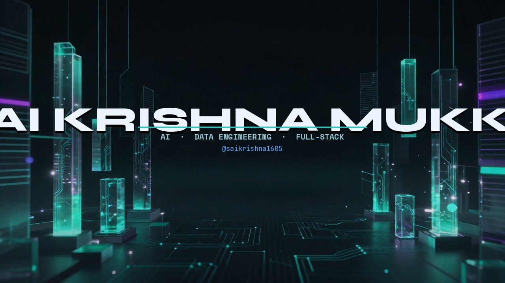
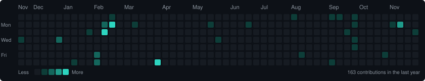

  

 

  

 

  <h2>Sai Krishna Mukka</h2>
  

    Computer Science student with hands-on experience in
    <b>AI</b>, <b>Data Engineering</b>, and <b>Full-Stack Development</b>.
  

  

    Building scalable web applications and AI-based solutions ·
    Enhancing cloud performance and data-driven insights
  

 

 

---

### Tech Stack

<b>Frontend & UI</b>

 

<b>Backend & APIs</b>

 

<b>Data, AI & Analytics</b>

 

<b>Cloud, DevOps & Hardware</b>

 

 

---

### GitHub Stats

  
  

  

 

### Contribution Activity

  

 

  

 

  <picture>
    <source media="(prefers-color-scheme: dark)" srcset="https://raw.githubusercontent.com/saikrishna1605/saikrishna1605/output/github-contribution-grid-snake-dark.svg" />
    <source media="(prefers-color-scheme: light)" srcset="https://raw.githubusercontent.com/saikrishna1605/saikrishna1605/output/github-contribution-grid-snake.svg" />
    
  </picture>

 

### GitHub Trophies

  

 

---

  
   
  Open to collaborations in AI, data, and full-stack systems

